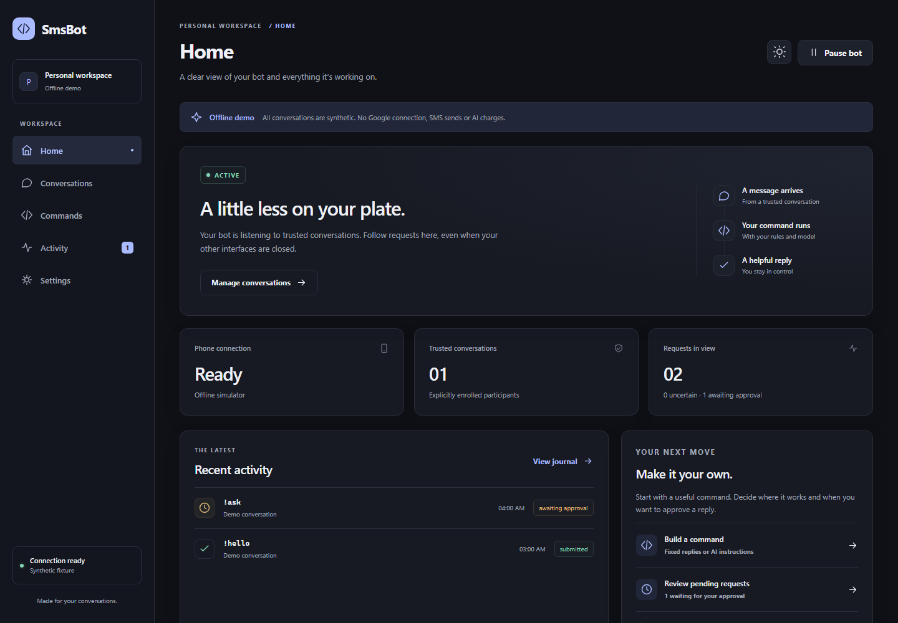
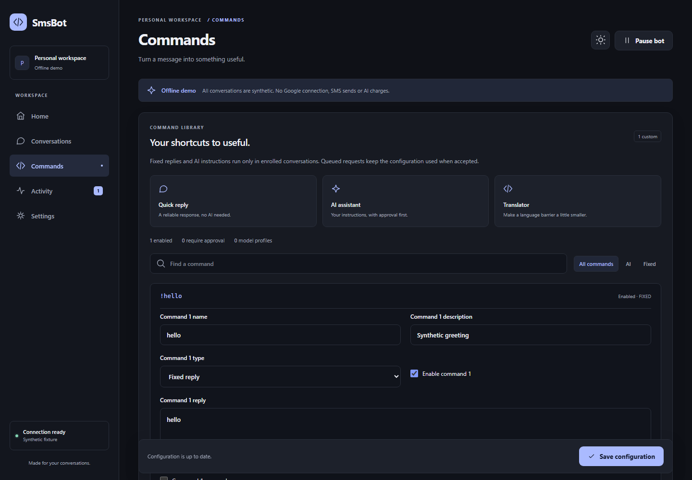

# SmsBot Server

A self-hosted personal command bot for a paired Google Messages phone, with a React/TypeScript dashboard and the native SmsBot Android client. **Development milestone, not a production release.**

## Implemented

- Authenticated owner dashboard and revocable Android client credentials.
- Individual conversation enrollment using protocol participant IDs; groups excluded.
- Built-in checks/reset commands and custom fixed/AI commands through OpenRouter; encrypted immutable plans, duplicate protection, pause, approvals, cancellation and stale-command rejection.
- Cached model catalog, profiles, per-model reasoning/temperature controls, scoped opt-in memory, quiet hours, request limits and reported-spend thresholds.
- Offline playground, disabled recipe imports (including Android command packs), retained text history/search/pagination, explicit phone-text import and manual compose.
- Retention, encrypted offline backup/restore, and optional direct TLS or exact-origin private HTTPS proxy support.
- Encrypted message bodies, queued plans and pairing sessions. SQLite WAL on local disk; master key outside the database directory. Windows key protection uses CurrentUser DPAPI.
- Persisted outbound transaction IDs; interrupted submissions become uncertain and are not automatically retried. Correlated Google status events can advance submitted/delivered/read state.
- Explicit offline fixture transport, with synthetic conversations and no Google or provider connections.
- Responsive dark web workspace with a light-theme toggle, searchable conversations and activity, disabled command templates/duplication, model search, protected configuration drafts and confirmed manual compose.
- Opt-in paired transport and local cookie/emoji pairing helper, pinned to the tested libgm revision.

The Android app's Settings > Self-hosted server connects with a revocable client credential. Server mode disables local SMS/notification automation, cancels eligible queued work and leaves local mode paused when restored. The Android app remains a native Kotlin/Compose interface.

## Not implemented or verified yet

The paired transport sends a complete reply up to the configured character cap; Android-only SMS segment/SIM controls do not apply. Text-history import is explicit, respects retention, excludes attachments and never routes imported commands. Exhausting available pages does not establish complete Google history.

Provider generation and delivery acceptance on the real phone, personal HTTPS/private-network setup, locked/open/background-phone cases, sustained authentication and browser handoff remain owner-controlled acceptance checks. Automated provider checks use local mocks or the HTTP-free fixture provider. Public hosting, portable cross-platform key recovery and attachment history are outside this development milestone.

The owner reports a successful live `!ping` after cookie recovery. Full live acceptance, reconnect behavior, long-term uptime, locked-phone behavior, competing paired clients and Linux live Google operation remain pending. Offline Linux container startup/recovery has been rehearsed. Network/authentication events pause automation; restart and inspect before reenabling. Do not promise unattended reliability yet. See the [completion plan](docs/COMPLETION_PLAN.md) for feature, client and deployment work alongside authentication observation.

## Develop on Windows

Go 1.27.2 toolchain and Node.js 24 are pinned for this milestone. Dependencies are locked in go.mod/go.sum and web/package-lock.json.

```powershell
.\build.ps1
.\start.ps1                  # Fixture mode, starts paused
```

Open `http://127.0.0.1:8787`. Read the owner credential file locally as directed by the launcher and paste it into the dashboard. Do not send that credential to a coding agent. Secrets/state live in the local application data directory, outside source. Fixture and Google environments use different directories.

Enroll a demo conversation, enable the fixture bot, select the conversation and use **Simulate !ping**. Activity will show submitted; fixture mode makes no claim of delivery. The service runs while the browser is closed. Ctrl+C stops it cleanly; every startup pauses automation and cancels eligible old queue entries.

## Pairing for controlled live acceptance

Google session cookies provide broad account access. Use your own account and follow [upstream pairing guidance](https://docs.mau.fi/bridges/go/gmessages/authentication.html). Keep credentials local. Do not reuse/import the prototype vault automatically.

1. Pause the existing Android/prototype bot and any server instance handling the designated conversation.
2. In a private browser session, pair Messages for web and copy the `/web/config` request as cURL (bash), as in the proven prototype workflow.
3. Run locally:

```powershell
.\start.ps1 -Transport Google -Pair
```

4. Approve the displayed emoji on your phone. Clear sensitive clipboard data yourself.
5. Run `.\start.ps1 -Transport Google`. It starts paused. Review exact enrollment in the authenticated dashboard; enable only for a designated test thread.

Google Messages chooses SMS/RCS and fallback; the server does not force RCS. The phone must remain online. Only complete fresh incoming text is routed; historical data, outgoing echoes and untrusted participants cannot run commands. The initial conversation picker shows the first 25 inbox threads.

### Update cookies without pairing again

For an existing pairing with rejected credentials, stop the Google service with Ctrl+C. In the same private browser session and Google account used for pairing, copy a fresh `/web/config` request as cURL (bash), then run locally:

```powershell
.\start.ps1 -Transport Google -UpdateCookies
```

This offline command reads the clipboard through stdin, takes the service state lock, saves an exact encrypted backup beside `google-session.enc` with a unique `.before-cookie-update-*.enc` suffix, and updates imported cookies while preserving pairing keys, identities, tokens and other session fields. The optional imported cookie is removed if absent from the new input; other server-acquired cookies are preserved. It refuses missing/incomplete pairing state or a running service and makes no Google requests. Use the same account; the offline command cannot verify account ownership or credential validity. Backups remain encrypted sensitive state outside source.

Clear your clipboard locally, close the private window without signing out, and run `.\start.ps1 -Transport Google`. Leave automation paused. Successful cookie replacement does not prove authentication works or explain a previous 401; paused startup checks phone readiness. Do not use `-Pair` to overwrite an existing pairing. If startup still fails, preserve the session and its backup for further diagnosis.

## Android development connection

On a **disposable emulator**, install the Android debug APK and use:

```powershell
adb -s YOUR_EMULATOR_SERIAL reverse tcp:8787 tcp:8787
```

Create a client credential in web Settings, then enter `http://127.0.0.1:8787` and that credential in Android Settings > Self-hosted server. Debug builds permit loopback HTTP only. Release clients require HTTPS. The server currently binds only to loopback; real remote mobile access requires a separately designed TLS/private-access deployment slice. No permanent administrator key is embedded in Android.

## Validation

```powershell
.\build.ps1
.\security-check.ps1
cd web
npx playwright install chromium
npm test
```

Playwright starts its own isolated fixture service and ephemeral synthetic credentials. Tests never contact Google, carriers or AI providers. See [validation](docs/VALIDATION.md), [architecture](docs/ARCHITECTURE.md), [security](docs/SECURITY.md), and [roadmap](docs/ROADMAP.md).

## License

AGPL-3.0-or-later. The paired adapter uses [mautrix/gmessages libgm](https://github.com/mautrix/gmessages/tree/main/pkg/libgm); its license and notices must be preserved. The separate Android project retains its existing MIT license. Do not copy upstream server code into Android under an assumed MIT license.

## Configure the server bot

In web Commands, create fixed replies with `{input}` or AI instructions; select a model/profile, optional memory, restrictions and approval. In Settings, refresh the public OpenRouter catalog explicitly, select per-model generation preferences and enter the provider key in the owner-only form. Keys are encrypted and never returned to either client. Fixture AI uses a deterministic synthetic provider and requires no real key.

AI input and opted-in context are sent to OpenRouter. Generation parameters are validated against cached capabilities and enforced through `require_parameters`; model-default reasoning/temperature are omitted. New default-model selections seed Low when advertised; explicit/legacy preferences remain intact. Queued inputs, instructions, context and generation controls are snapshots. Revoking memory or resetting it invalidates queued context and prevents an in-flight answer from repopulating deleted memory.

Approvals and queued plans expire after two minutes in this service. Requests are counted globally in rolling-hour/UTC-day limits, including manual messages. Quiet hours withhold requests rather than deferring them. The daily monetary control is a reported-spend threshold with a conservative pre-call estimate, not a provider billing guarantee; missing pricing/unknown spend blocks further AI when the threshold is enabled. Zero disables that threshold. No automatic provider retries are added, and uncertain message submissions are never retried.

Server recipe import replaces configuration with commands disabled; Android `smsbot.commands` v1 packs append disabled commands, reject duplicate names/sender restrictions, preserve explicit generation overrides and omit SMS segment settings. Server keys, enrollments and local phone secrets are never automatically migrated.

See [feature parity](docs/PARITY.md), [recovery](docs/BACKUP.md), [API contract](api/openapi.yaml) and [validation](docs/VALIDATION.md).




