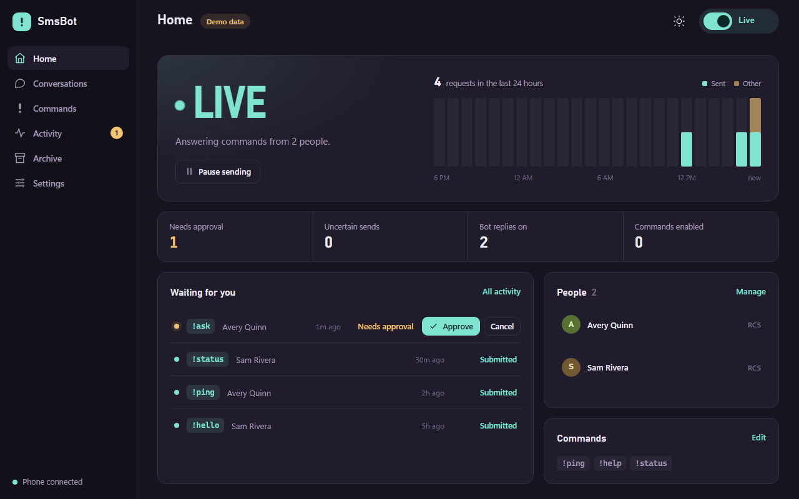

# SmsBot Server

A self-hosted dashboard, message archive and command bot for your own Google Messages
account. It runs as one small service, works in a browser or as an installed phone app,
and can answer commands you define (fixed text or AI) in the conversations you choose.



> **Experimental, use at your own risk.** SmsBot talks to Google Messages through an
> unofficial, reverse-engineered client ([libgm](https://github.com/mautrix/gmessages/tree/main/pkg/libgm)).
> Google can change or block it at any time, and using it may conflict with Google's
> terms. Read [Security and limitations](docs/SECURITY.md) before pairing a real account.

## What it does

- **Messages dashboard.** Your individual conversations with read status, typing
  indicators, attachments, RCS replies and reactions, search and push notifications.
- **Local archive.** An encrypted copy of the conversations you choose, including
  original files, with exports, backup and restore.
- **Command bot.** Built-in commands plus your own fixed or AI commands, with approvals,
  quiet hours, and rate and spending limits. `!ask` keeps a threaded AI conversation
  you continue by replying. AI uses OpenRouter or any OpenAI-compatible endpoint.
- **Careful by design.** Only people you enroll can trigger replies, groups are never
  used, every start is paused, and a send with an uncertain outcome is never retried.


## Quick start (offline demo)

You need Go 1.27.3 and Node.js 24.15 or newer in the 24.x series. On Windows:

```powershell
.\scripts\build.ps1  # builds and tests everything
.\scripts\start.ps1  # offline demo with synthetic conversations
```

Open <http://127.0.0.1:8787> and sign in with the owner credential from the file the
launcher prints. The demo never contacts Google or an AI provider. For Linux, Docker,
pairing your account and phone access, see [Getting started](docs/GETTING_STARTED.md).

## Documentation

| Guide | Contents |
|---|---|
| [Getting started](docs/GETTING_STARTED.md) | Build, demo, pairing, phone access, hosting, backup |
| [User guide](docs/USER_GUIDE.md) | Every page and setting, commands and `!ask` |
| [Security and limitations](docs/SECURITY.md) | Risks, what is stored, what isn't supported |
| [Architecture](docs/ARCHITECTURE.md) | How the service is put together |
| [Contributing](CONTRIBUTING.md) | Development workflow and checks |
| [API](api/openapi.yaml) | OpenAPI description of the owner API |

## License

AGPL-3.0-or-later, see [LICENSE](LICENSE). Licenses of bundled dependencies, including
libgm, are in [THIRD_PARTY_NOTICES.md](THIRD_PARTY_NOTICES.md).
