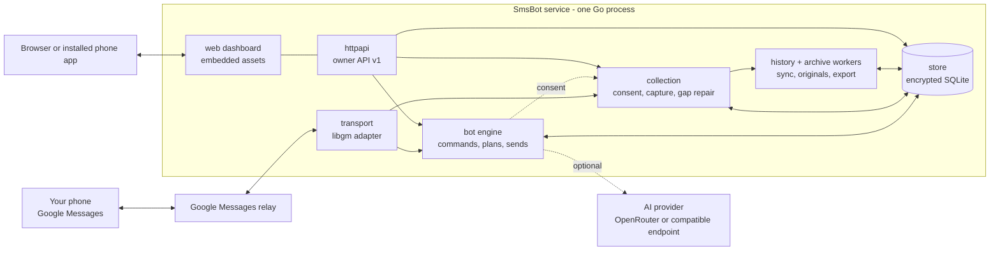

# Architecture

SmsBot is a single Go service with an embedded React dashboard. It pairs with your
Google Messages account the way Messages for web does, keeps an encrypted copy of the
conversations you choose, and answers commands you define.

## Packages

| Package | Responsibility |
|---|---|
| `cmd/smsbot` | Command line: serve, initialize, pair, update cookies, backup and restore. |
| `internal/app` | Wires the services together, runs startup in order (recover and pause before connecting), and owns every background worker. |
| `internal/transport` | Conversation and message types, the Google adapter (libgm) and the offline fixture used by the demo and tests. |
| `internal/store` | SQLite with migrations and encrypted payloads: jobs, messages, enrollment, AI threads, credentials, backups. |
| `internal/vault` | The master key and AES-GCM encryption. Windows uses DPAPI; Linux uses an owner-only key file. |
| `internal/bot` | Command routing, AI generation, and the dispatcher that sends replies and your own messages. |
| `internal/collection` | Which conversations are archived, capturing their messages, and read receipts. It never sends. |
| `internal/history` | Background reads that fill the archive. History never runs commands. |
| `internal/archive` | Original files, storage statistics, exports and restore. |
| `internal/notify` | Web Push notifications for each device. |
| `internal/media` | Attachment validation and limits. |
| `internal/httpapi` | The owner-only JSON API ([OpenAPI](../api/openapi.yaml)), sessions, and the embedded dashboard. |
| `web/` | The React and TypeScript dashboard; see [web/README.md](../web/README.md). |

## How a reply is sent

1. A fresh text message arrives from an enrolled person in an individual conversation.
2. If it's a command, the bot stores an encrypted, unchangeable plan and a job.
3. Just before sending, the checks run again: enrollment, pause, freshness and quiet hours.
4. The outgoing message is recorded before it's handed to Google. The job then becomes
   `submitted`, or `unknown_submission` if the result can't be known.

Messages you type in the dashboard follow the same steps, keyed so that a retry never
sends twice.

## Safety rules

- **Exact participants.** Only individual conversations, matched by participant ID.
  Groups are excluded.
- **Fresh input only.** History, outgoing echoes and messages with files never run
  commands.
- **Record before sending, never retry the uncertain.** An unknown outcome is shown to
  you and is never retried automatically.
- **Pause wins.** Every start is paused, and pausing cancels queued work.
- **Plans don't change.** Editing a command doesn't affect requests already queued.
- **No secrets in logs.** Message text, contacts, credentials and raw errors from Google
  are never logged.

## Where things live

- **Sending:** `bot.Engine.Dispatch` runs each job's steps under one lock and releases it
  only while waiting on the AI provider or uploading files.
- **AI threads:** each `!ask` answer is linked to its upstream message ID, so a native
  reply to it continues that thread. Only the replied-to branch is sent as context. A
  photo quoted with an AI command is planned by reference and read only while
  generating, through the same access checks as the dashboard.
- **Archive sync:** each workflow (import, recent check, viewed section) keeps its own
  checkpoint, and `internal/history/plan.go` decides what runs next.
- **Database access:** queries live in `internal/store` as named operations.
- **Dashboard state:** `useDashboard` owns app-wide polling; `useConversationMessages`,
  `useThreadScroll` and `useComposer` own a single conversation.
- **State on disk:** the data directory holds `smsbot.db`, the encrypted Google session
  and archived files; the key lives elsewhere. A lock stops two processes from using
  the same directory.
