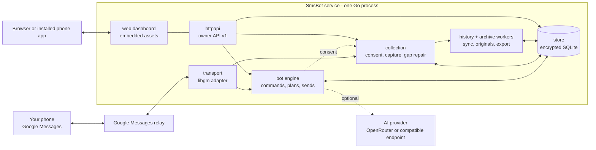

# Architecture

SmsBot is a single Go service with an embedded React dashboard. It pairs with your
Google Messages account the way Messages for web does, keeps an encrypted copy of the
conversations you choose, and answers commands you define.

## Packages

| Package | Responsibility |
|---|---|
| `cmd/smsbot` | Command line: serve, initialize, pair, update cookies, backup and restore. |
| `internal/app` | Wires the services together, runs startup in order (recover and pause before connecting), and owns every background worker. |
| `internal/transport` | Conversation and message types, the Google adapter (libgm) and the offline fixture used by the demo and tests. |
| `internal/store` | SQLite with migrations and encrypted payloads: jobs, messages, enrollment, AI threads, credentials, backups. |
| `internal/vault` | The master key and AES-GCM encryption. Windows uses DPAPI; Linux uses an owner-only key file. |
| `internal/bot` | Command routing, AI generation, and the dispatcher that sends replies and your own messages. |
| `internal/collection` | Which conversations are archived, capturing their messages, and read receipts. It never sends. |
| `internal/history` | Background reads that fill the archive. History never runs commands. |
| `internal/archive` | Original files, storage statistics, exports and restore. |
| `internal/notify` | Web Push notifications for each device. |
| `internal/media` | Attachment validation and limits. |
| `internal/httpapi` | The owner-only JSON API ([OpenAPI](../api/openapi.yaml)), sessions, and the embedded dashboard. |
| `web/` | The React and TypeScript dashboard; see [web/README.md](../web/README.md). |

## How a reply is sent

1. A fresh text message arrives from an enrolled person in an individual conversation,
   or from an enrolled member of a group whose people are as the owner approved.
2. If it's a command, the bot stores an encrypted, unchangeable plan and a job.
3. Just before sending, the checks run again: enrollment, pause, freshness and quiet hours.
4. The outgoing message is recorded before it's handed to Google. The job then becomes
   `submitted`, or `unknown_submission` if the result can't be known.

Messages you type in the dashboard follow the same steps, keyed so that a retry never
sends twice.

## Safety rules

- **Exact participants.** In an individual conversation the bot acts only for the enrolled
  person, matched by participant ID. A group can be read and archived, under a fixed identity of its own
  (`group:` and its conversation ID) so membership changes don't interrupt it; its
  `roster` names exactly who is in it. The owner can send to a group, but only as the
  roster they were shown: the request, the queued plan, the pre-send check and the
  transport's own lookup all compare it, and a change cancels the send. The bot runs
  in a group only for members the owner enrolled (`group_enrollment`: conversation,
  member, approved roster) and only while the live roster is the approved one; a change
  silences it until the owner approves again, and each member has their own AI memory
  and threads, unless the owner switched that group to one shared conversation
  (`group_shared`): memory and threads then belong to the fixed owner `shared:group`,
  questions carry an anonymous asker label, and only the owner's `!new` clears it. The owner's own commands from the phone
  (when allowed) run in any group they can send to, as the fixed participant
  `owner:self`: the reply is planned for the roster at that moment and cancelled if it
  changes before it goes.
- **Fresh input only.** History and outgoing echoes never run commands. A message
  runs one only if it is a command or a reply to an AI answer; a file it carries
  goes to the AI. A file alone, not replying to an AI answer, never runs one.
- **Record before sending, never retry the uncertain.** An unknown outcome is shown to
  you and is never retried automatically.
- **Pause wins.** Every start is paused, and pausing cancels queued work.
- **Plans don't change.** Editing a command doesn't affect requests already queued.
- **No secrets in logs.** Message text, contacts, credentials and raw errors from Google
  are never logged. `Send:` journal entries report whether a send used a native
  reply, its fixed result code, and numeric conversation protocol (2 is RCS) and
  upstream send status. Results distinguish lookup failure, missing baseline or
  SIM, identity/roster changes, non-RCS reply refusal, upstream rejection and
  uncertain submission. A refused reply followed by a plain send can be traced
  by their timestamps; no recipient or transaction identifiers are logged. The same
  fixed result code is kept with a failed request (`reason`) so Activity can
  explain it; free text is never stored there. The phone's SIMs are reported to
  the owner as slot, carrier and the last four digits only.

## Where things live

- **Sending:** `bot.Engine.Dispatch` runs each job's steps under one lock and releases it
  only while waiting on the AI provider or uploading files. A plan's attachment bytes
  are sealed apart from the job row (`job_files`, bound to the job and checked against
  the plan), so a state change rewrites a small row, and they are removed with the plan.
- **Download commands:** an encrypted plan snapshots the URL and independent
  execution deadline (15 minutes by default, up to 60). Admission still requires
  fresh input. Dispatch makes short idempotent requests to a token-authenticated
  worker: the local one, or one on another PC over Tailscale, chosen per video and defers its next poll in `job_work`, letting other sends run.
  One background upload lane also yields dispatch; its results are committed only
  by dispatch after repeating safety checks. Activity exposes sanitized stages. The single-slot worker keeps
  originals, verified MP4 results and job state as plain files in the owner-only
  downloads folder; checkpoints survive worker restart.
  Progress watchdogs and a renewable lease stop stalled or unauthorized work.
  Every normal enrollment, pause, attachment and send check still applies, with
  the execution deadline replacing post-acceptance freshness for these jobs.
  Restarting SmsBot still pauses and cancels unsent jobs. Checkpoints alone never
  authorize a send. See [Download command](DOWNLOAD_COMMAND.md).
- **AI threads:** each `!ask` answer is linked to its upstream message ID, so a native
  reply to it continues that thread. Quoting the prompt is optional: after a definite
  native-reply non-submission, the same recorded answer and transaction may be sent
  as a regular message through the normal recipient checks. Uncertain outcomes never
  fall back. Only the replied-to branch is sent as context. A
  message quoted with an AI command brings the chain of replies above it into the
  prompt, each hop resolved within the same conversation. A file it quotes or carries is
  planned by reference and read only while generating, through the same access checks as
  the dashboard. `internal/bot/attachments.go` decides how each kind is read: photos are
  shrunk, and HEIC is converted to JPEG (`internal/media/shrink.go`, with the pure-Go
  WebAssembly decoder in `github.com/gen2brain/heic`, never a host libheif), text and office documents (`documents.go`, standard-library zip and XML with
  a cap on what is unpacked) become prompt text for any model, and PDFs, audio and video
  go to the provider as they are. The model's catalog modalities are not used to refuse a
  file; a provider that rejects it (HTTP 4xx) is reported in the chat.
- **Archive sync:** each workflow (import, recent check, viewed section) keeps its own
  checkpoint, and `internal/history/plan.go` decides what runs next. Discovery, which
  finds the conversations to archive, runs every 15 minutes when idle; turning
  collection on, widening it to every conversation or selecting a new one runs it at
  once, so archiving starts when the owner asks.
- **Database access:** queries live in `internal/store` as named operations.
- **Dashboard URLs:** each page and open conversation has its own path
  (`/settings`, `/conversations/ID`), defined in `web/src/lib/routes.ts`, so Back,
  reload and bookmarks work. The server answers those paths with the app
  (`internal/httpapi/dashboard.go`); other unknown paths stay 404.
- **Dashboard state:** `useDashboard` owns app-wide polling; `useConversationMessages`,
  `useThreadScroll` and `useComposer` own a single conversation.
- **State on disk:** the data directory holds `smsbot.db`, the encrypted Google session
  and archived files; the key lives elsewhere. A lock stops two processes from using
  the same directory.

## Commands are pipelines

A command is configuration: the trigger (the command message) followed by a
linear list of steps. Each step runs one registered module
(the engine is [cmdflow](https://github.com/deusical/cmdflow), a separate
standard-library-only Go library; SmsBot is its host in `internal/bot/pipeline.go`,
and its modules are `modules_*.go`). A module declares typed input and
output ports (`text`, `url`, `file`, `video`, `stored_video`, `message`, `context`), a strict
settings schema, an effect class and retry/resource classes. Each input is bound
to `trigger.<output>` or an earlier `<step>.<output>` of a compatible type;
saving checks every binding, setting and rule (at most 8 steps, the reply last).
A command may make several AI requests, for example summarize and then
translate: each AI step's usage is kept in `usage_steps` and the job's `usage`
row is their total, so the daily budget is checked before every request and an
unknown cost on any step blocks further requests. Several AI steps, like a
long-running step, give the job the pipeline's execution deadline instead of
the two-minute window. The job's conversation turn is the AI step that reads a
conversation (else the first AI step); only it sets the plan's AI request
fields.

| Module | Does |
|---|---|
| `text.template` | Fixed text with `{input}` |
| `text.extract_url` | The one Douyin/Xiaohongshu link, or a usage reply |
| `message.question` | Question from the command text, its file and the messages it replies to |
| `context.none` / `context.rolling` / `context.thread` | Which AI conversation the request belongs to |
| `ai.chat` | One provider request; with a conversation, reads it and outputs it to continue |
| `video.download` | Server-local worker download; the original stays on the worker (`stored_video`) |
| `video.compress` | Send copy of a stored original, within the size ceiling |
| `reply` | The only sink: text and file to send, and the conversation it continues |

Acceptance snapshots the pipeline into the encrypted plan and runs the steps
whose inputs are known then (`immediate` modules); a step can decline the command
(no usable model) or end it early with a reply (no link, unreadable file,
expired thread). Dispatch runs the remaining steps in order; long steps yield
through `job_work`. Modules never send. The reply step's inputs are an intent
that fills the plan's text and attachments only at dispatch, after every
earlier step; uploads, every pre-send check, the persisted outbound intent and
uncertain-send handling stay in the dispatcher. A queued job whose stored run
this version can't read (one saved by an older version before an upgrade)
fails once with `pipeline_unavailable` and sends nothing.

An AI conversation is a value: a context module names it, `ai.chat` loads its
earlier turns with its own model and budget, and the reply's `continues` input
records the new turn only after submission. A native reply to an AI answer
continues the command that answered (the thread records its command).
Changing a command's conversation kind or turning memory off withdraws consent.

`internal/bot/kinds.go` keeps the built-in templates `fixed.reply@1`,
`ai.generate@1` and `media.video@1`: settings forms whose pipelines reproduce the
original commands exactly. Kind `pipeline` is configured by its steps and is
saved with legacy type `fixed` and no text, which older servers never send.
Legacy flat fields and recipes are still accepted and normalized; unknown
settings are rejected.

The owner API exposes templates at `/api/v1/command-kinds` and modules at
`/api/v1/command-modules` (also under `/api/`). The editor chooses controls from schema UI hints. Config
GET returns a whole-configuration revision; PUT with an obsolete revision returns
409 atomically. Revisionless legacy clients retain full-replacement last-writer-wins
semantics. No settings merge is performed, and unknown settings fail validation.
Recipe import intentionally starts a new configuration revision rather than using
the exported revision. Command revisions identify the configuration that saved them.

Configuration and recipe request bodies allow 4 MiB during dual representation
storage so legacy configurations remain editable when settings duplicate flat
command fields. The command/profile counts and per-field bounds remain enforced.

## Phone replacement

The owner API exposes a bounded, cancellable phone-pairing task. Its maintenance
gate drains ordinary API requests before pausing automation and stopping every
worker. Transport recovery probes also finish before the old client closes, so
none can save an obsolete session over the replacement. Pairing writes a separate
encrypted session before replacing the current one and keeping an encrypted backup.
The service rebuilds its transport, engine, collection and worker objects to discard
old identity caches, then reconnects, still paused. Failure to pair reconnects the
previous session; failure to reconnect keeps maintenance enabled. Status and emoji
are transient; credentials and upstream errors never appear in the task status.
The dashboard can read minimal authenticated state during maintenance, including
after a reload. New conversation identities always require explicit enrollment;
existing exact-participant, roster, immutable-plan and uncertain-send checks apply.
