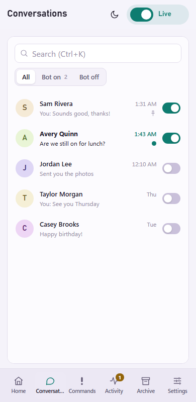
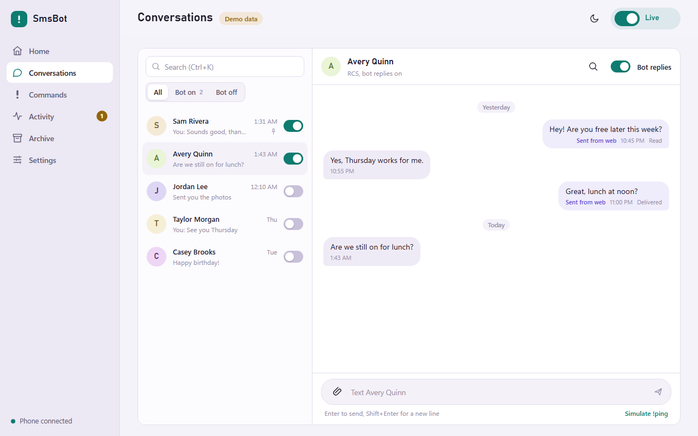
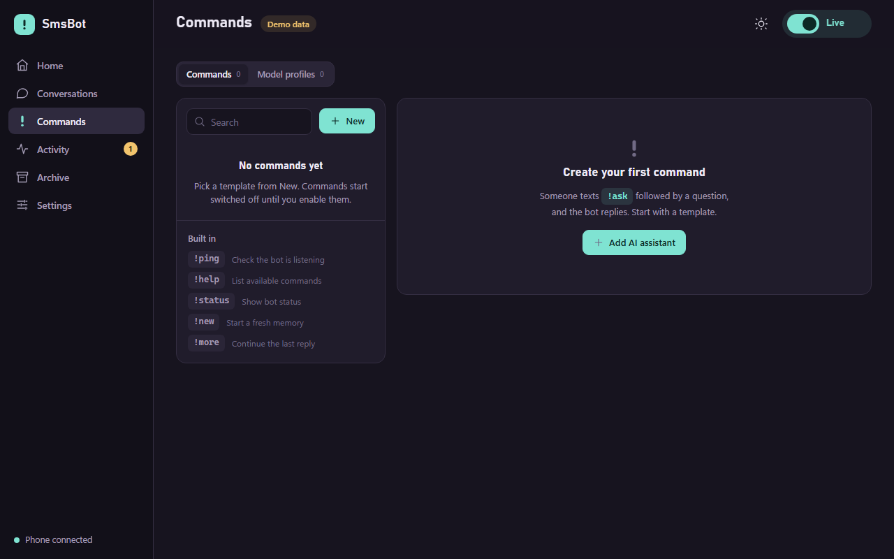
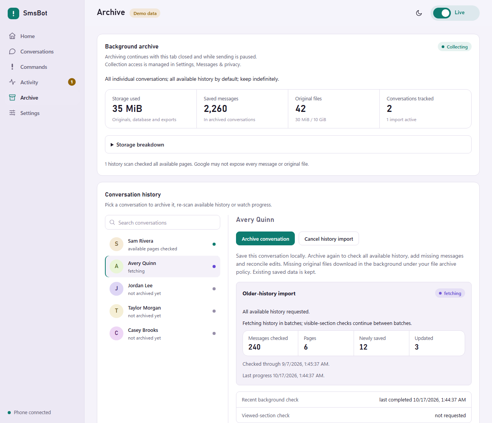

# User guide

The dashboard follows your system's light or dark theme (switch it in the top bar) and
uses a bottom tab bar on phones. Served over HTTPS, it installs as a phone app. On the
sign-in page, **Keep me signed in** keeps you signed in until you sign out.

## Top bar

The **Live / Paused** switch controls all sending. Pausing cancels queued replies but
can't recall a message already sent. Every start of the service is paused.

## Home

The current status, a 24-hour activity chart, anything waiting for your approval (with
**Approve** and **Cancel**), recent requests, and shortcuts to people and commands.

## Conversations

Your individual conversations, newest first, with pinned chats on top, unread dots,
previews and typing indicators. The **Bot replies** switch on each row lets that person
use commands.

- **Sending.** Enter sends; Shift+Enter adds a line. Paste or drop files to attach them.
  A message shows **Sending**, then **Sent**, **Delivered** and **Read**. If the server
  didn't confirm it, **Retry sending** is safe and never sends twice. If the outcome is
  uncertain, you're asked to check your phone instead.
- **Message menu.** Hover a message and click its ⋯ button, or tap it on a phone, for
  **Copy text**, **Details** and, on RCS messages, **Reply** and reactions. If Reply
  isn't available, the menu says why.
- **Reading.** Search within a conversation, scroll up for older messages, and use the
  round button to jump back to the latest. Opening an unread conversation marks it read
  on your phone; turn that off in **Settings > Messages & privacy**.
- **Shortcuts.** **Ctrl/Cmd+K** searches conversations, **Alt+Up/Down** switches
  conversation, and **Ctrl/Cmd+S** saves settings.

## Commands

Commands are messages starting with `!`, sent by someone with bot replies on. The
built-ins are `!ping`, `!help`, `!status`, `!new` and `!more`. You can add your own:

- **Fixed** commands reply with set text, where `{input}` is replaced by whatever
  follows the command.
- **AI** commands send the input to a model you choose. They can require your approval
  before replying, and can be limited to certain conversations.

**New** offers templates (Quick reply, AI assistant, Translator); new commands start
disabled. **Try it** previews a command offline. Bot replies are limited per hour and per
day, and AI spending per day; your own messages never count toward these limits. Quiet
hours drop requests instead of delaying them. With **Commands from your phone** on, your
own messages can run commands too.

### Asking AI with `!ask`

- `!ask question` starts a new conversation with the AI.
- **Continue it** by using your phone's Reply on the AI's answer; you don't need `!ask`
  again. Replying to an older answer continues from that point. This needs **Remember
  the conversation** on for the command.
- **Ask about a message** by replying to it with `!ask question`. The AI sees that one
  message (up to 2,000 characters) and nothing else from the chat. Reply with just
  `!ask` to have the AI respond to the message.
- `!new` clears the AI's memory for that chat. Conversations also expire after the
  memory window (24 hours by default).

Replies need RCS. On SMS, send a new `!ask` with everything in it.

## Activity

Every request, filterable by state and searchable. Expand a row to see the model, usage
and cost, and approve or cancel from here.

## Archive

An encrypted local copy of the conversations you turn on under **Settings > Messages &
privacy**. It keeps running when the dashboard is closed and is separate from Live /
Paused.

- **Archive conversation** reads all available history, fills gaps and downloads the
  original files. Run it again to re-check.
- **Retention**, **original file archive** limits and **exports** (encrypted backup or a
  readable TAR of JSON and files) are set here.

Google doesn't always provide complete history, and importing history never runs old
commands.

## Settings

| Section | What it holds |
|---|---|
| AI models | Default model, favorites, per-model tuning |
| Providers | OpenRouter key, or any OpenAI-compatible URL and key |
| Limits & quiet hours | Bot reply limits, AI spending limit, quiet hours, reply length, commands from your phone |
| Messages & privacy | Which conversations are archived, read receipts, attachment limits, retention, AI memory window |
| Notifications | Per-device notifications |
| Devices | Phone connection, **Sign out everywhere** |
| Import & export | Share commands, profiles and settings as a file (never keys) |

Changes collect in a save bar; **Save changes** (or Ctrl/Cmd+S) applies them and
**Discard** undoes them. Imported settings arrive with every command disabled.

### Notifications

On each device you want notified, open **Settings > Notifications** and choose **Turn
on notifications**. Each device has its own settings:

- **Messages:** all, only conversations with bot replies on, only chosen conversations,
  or none. You can mute conversations and hide message text.
- **Alerts:** a reply waiting for approval, a failed reply, and the phone being offline
  for two minutes.

Messages older than ten minutes, such as history caught up after an outage, don't
notify. On iPhone, add SmsBot to the Home Screen first.

## Files

Attach images, video, audio or documents with an optional caption. Like the Google
Messages app, each file goes as its own message, followed by the caption. Images, audio
and video preview inline; other files download. Limits are under **Messages & privacy >
Attachment limits**. A message with an attachment never runs a command.
