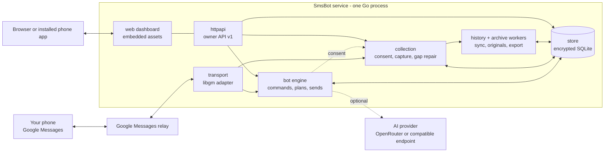

# Architecture

SmsBot Server is a single Go service with an embedded React dashboard. It pairs with
your Google Messages account like Messages for web, keeps an encrypted local copy of
the conversations you choose, and optionally answers commands you define.

## Packages

| Package | Responsibility |
|---|---|
| `cmd/smsbot` | Command line: serve, initialise, pair, update cookies, backup/restore, archive export/restore, `--version`. |
| `internal/app` | Assembles the service: constructs the engine, collection service and workers, runs startup work in order (recover and pause before connecting; preservation before expiry), routes transport events, and owns every worker goroutine. Nothing imports it. |
| `internal/transport` | Normalised conversation and message contracts. The fixture adapter is physically separate from the opt-in Google adapter (libgm). Google cookies and session live here and in encrypted storage only. |
| `internal/store` | SQLite (WAL) with schema migrations, sealed payloads, unique incoming jobs, enrollment, hashed credentials, backups. |
| `internal/vault` | Master key handling and AES-GCM sealing bound to a scope (job, message, session). Windows uses DPAPI; Linux requires a 0600 key file. |
| `internal/bot` | Command routing, immutable plans, provider generation, the serialized dispatcher, pre-send rechecks, receipt reconciliation, owner sends. It reads collection consent but owns no collection work. |
| `internal/collection` | The owner's message collection: settings and consent, observation capture, capture-gap repair, archive sync requests, collected inbox reads and read receipts, and the consent-checked hosts the history and original-file workers use. It never routes commands or submits messages, and does not import `bot`. |
| `internal/history` | Background reads that fill the local archive (recent reconciliation, older imports, viewed-section checks) without ever routing commands, and the bounded read shared by owner-requested history pages. |
| `internal/archive` | Streaming encrypted copies of original files, storage statistics, exports and offline restore. |
| `internal/media` | Attachment validation, limits and intent digests. |
| `internal/httpapi` | Owner-only JSON API, session cookies, exact Host and Origin checks, embedded dashboard. |
| `web/` | React and TypeScript dashboard. It polls the API and caches only static files. |

Collection and the bot share one control lock: consent changes, send decisions and
protected commits serialize on it. Cross-service reactions (stopping automatic
replies cancels in-flight generation) are wired explicitly in `internal/app`.

## Request flow

**Incoming command.** Fresh complete text from an exactly enrolled individual
participant passes pause and readiness checks, is routed to a built-in or custom
command, and becomes an encrypted immutable plan plus a unique persisted job. Just
before sending, enrollment, freshness and identity are checked again. The
transaction ID and a `submitting` state are persisted before the transport call, and
the result is `submitted` or `unknown_submission`.

**Message you type in the dashboard.** The composer clears at once and shows a
pending bubble. The server records the intent under a per-message idempotency key,
then follows the same checks and persisted-before-submit steps. Statuses advance
through Sent, Delivered and Read as Google reports them.

**History.** The archive reads available history in bounded pages. Everything it
saves is stored for viewing only: historical messages never execute commands and
never change Live/Pause.

## Safety rules the code is built around

- **Exact participants.** Only an individual conversation identified by its protocol
  participant ID can be enrolled or collected. Names are labels. Groups are excluded.
- **Fresh input only.** Old, historical, outgoing-echo and file-bearing messages
  never run commands.
- **Persist before submit.** The outbound intent is stored before the transport call.
- **Never retry the uncertain.** After a transport call whose outcome is unknown the
  job becomes `unknown_submission`. It is never retried automatically, and the UI offers
  no retry for it.
- **Pause is authoritative.** Every start is paused. Pausing cancels queued, generating
  and approval work. Pause cannot retract a message already submitted.
- **Immutable plans.** Changing configuration after a request is queued does not change
  that request.
- **No secrets in logs.** Message bodies, contacts, credentials and raw upstream errors
  are never logged. Persistent payloads are encrypted.
- **Owner only.** There is a single owner. API calls need an owner browser session;
  bearer credentials are not accepted.

## Configuration and state

State lives in a data directory (`smsbot.db`, the encrypted Google session, archived
originals); the master key lives outside it. A state directory is locked while the
service or an offline command uses it. Backups and archive exports are offline
operations described in [BACKUP.md](../BACKUP.md).

## More detail

[DESIGN_NOTES.md](DESIGN_NOTES.md) records the finer design points per subsystem:
processing, history synchronization, attachments, archive module, reconnection,
sync scheduling, storage statistics and instant send. The API contract is
[api/openapi.yaml](../../api/openapi.yaml).
